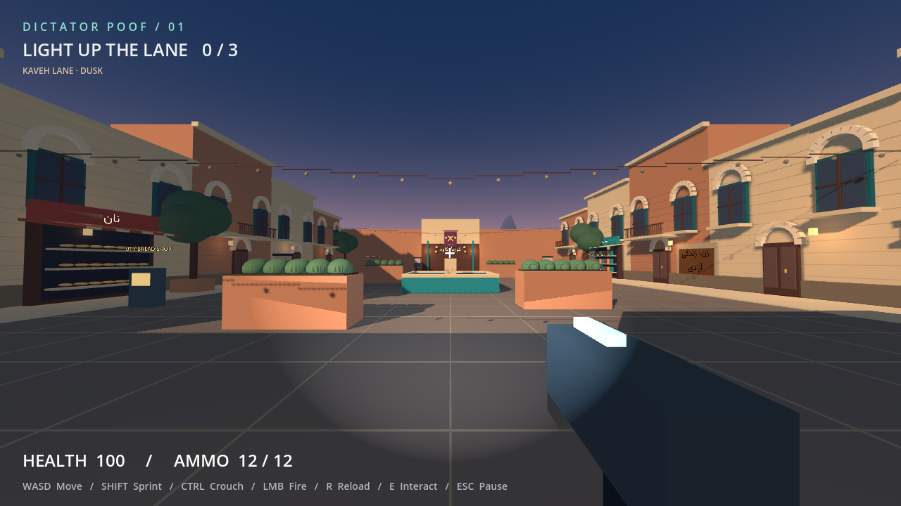

# Dictator Poof

**Nowruz. A garden, a family, and the first visit of the year.**


A first-person resistance game set in a fictional Iranian neighborhood.
The opening follows a family through Nowruz: wake up, open the garden blinds,
stop for pastries, face a morality patrol with your sister, and gather at your
grandparents' home for Sal Tahvil, lunch, and Hokm. The book café serves coffee
at outdoor tables and carries four real Persian literary titles with original
cover designs and short descriptions. Story text supports English and Persian.

Ramadan is reserved for a later chapter. The Nowruz café serves during the day.
The family walks to the car and into the houses; trips use a moving back-seat
view. A marked patrol van arrives and two uniformed officers approach before
the bakery confrontation. Relatives eat at the table while a cook works at
the counter. Interiors include original patterned carpets, tilework, curtains,
ceramics, and chandeliers. Hokm is one four-player partnership hand. Progress
lasts for the current session.

Choose **Kaveh Lane / Night Mission** on the title screen for the original mission:

Restore the three amber power boxes, then return to the speaker beside the
rug near your starting point. Each restored box lights nearby homes and heals
25 health. Evade or fight the patrols. After winning, choose **Join your
friends** to explore the lit street, or **Replay the night** to start again.

The north passage leads to a private courtyard house. Guests dance, share wine,
and joke together. Speak with the host to hear why the gathering must stay
private. A patrol entering the house breaks up the party.

## Play

Import `project.godot` into **Godot 4.7.2 Standard**, then press **F5**.
No .NET SDK or export is needed.

| Control | Action |
| --- | --- |
| WASD / mouse | Move / look |
| Shift / Ctrl / Space | Sprint / crouch / jump |
| E | Advance nearby story interactions, browse books, order coffee, sit or speak |
| F | Drink water in the family chapter |
| Mouse / left click | Choose trump and play legal cards at the Hokm table |
| Left click / R | Fire / reload in the night mission |
| H | Holster or draw the gun in the night mission |
| F2 | Switch between English and Persian during play |
| Esc | Pause / resume |

Entering the lane starts a short flourish followed by looping background music.
Adjust it with **Music volume**; **Sound** mutes music and effects.
See [music credit](docs/MUSIC.md).

The menu offers language, sound, music volume, blood, and sensitivity settings. The neighborhood is
still a stylized prototype with procedural characters and geometry.
It is not a finished realistic city or a completed historical campaign.

## Contribute

To contribute, fork this repository, create a branch in your fork, and submit
a pull request to this repository. Collaborators with write access may create
a branch here directly. See [CONTRIBUTING.md](CONTRIBUTING.md) for guidelines.

Example contribution: add another graffiti slogan.
Open `scenes/graffiti_wall.tscn`, duplicate the **Slogan** node, and give the
new node a descriptive name. Edit its **Text** in the Inspector, then adjust
its position and font size so both slogans fit on the wall without overlapping.
Keep the Persian language and right-to-left settings, and enter Persian text
in reading order; do not reverse it. You can write in other languages, as well. Save, open `scenes/graffiti_preview.tscn`,
and press **F6** to check the result. Include the slogan's meaning and any
historical source in your pull request.

The family chapter lives in [nowruz.gd](scripts/nowruz.gd), with shared
[café](scripts/book_cafe.gd), [furniture](scripts/domestic_props.gd), and
[Hokm rules](scripts/hokm_rules.gd). The night neighborhood is built in
[world.gd](scripts/world.gd). [Nowruz choreography](scripts/nowruz_life.gd)
coordinates arrivals; [actor motion](scripts/actor_motion.gd) follows authored
routes with swept collision. The two encounters share [patrol art](scripts/patrol_visual.gd).
Mission state lives in [game.gd](scripts/game.gd),
movement in [player.gd](scripts/player.gd), and patrol behavior in
[guard.gd](scripts/guard.gd). See [the party house notes](docs/PARTY_HOUSE.md)
for the new scene and reusable character model.

## [docs/Iran WORLDBUILDING.md](docs/IRAN%20WORLDBUILDING.md)

Use **[docs/Iran WORLDBUILDING.md](docs/IRAN%20WORLDBUILDING.md)** as the greatest source of inspiration and ideas for this project.

[Story and creative direction](docs/STORY.md) · [Iran references](docs/RESEARCH.md)

## License and project identity

Original source code is licensed under [GPL-3.0-or-later](LICENSE). The
project was founded and is directed by **Autrin Hakimi**. Original documentation
and procedural art use the same license unless otherwise identified. Preserve
applicable copyright, license, and warranty notices when redistributing; see
[NOTICE](NOTICE) for scope and distribution requirements, including the
mandatory preservation of copyright and author attribution under GPLv3
section 7(b). Separate releases under different names are allowed, but must
retain credit for Autrin Hakimi and contributors in their accompanying notices.
Avoid implying official
endorsement of modified releases; see [TRADEMARKS.md](TRADEMARKS.md).
Contributors are welcome and credited in [CONTRIBUTORS.md](CONTRIBUTORS.md).
For optional reuse credit, see [CITATION.cff](CITATION.cff).

## Checks

With Godot on PATH:

```sh
godot --headless --path . --editor --import --quit
godot --headless --path . --fixed-fps 60 --script tests/nowruz.gd
godot --headless --path . --fixed-fps 60 --script tests/smoke.gd
```

Tested on Windows with Godot 4.7.2: integration checks cover the family story,
Hokm, café interactions, language switching, collision, and the night mission.
Rendered views were inspected on an RTX 4070 Laptop GPU.
A full manual playthrough and performance benchmark remain to be done.

## Credits

Original code and procedural art: [GPL-3.0-or-later](LICENSE).
Bundled Persian font: [Vazirmatn, SIL OFL 1.1](assets/fonts/vazirmatn/OFL.txt),
by the Vazirmatn Project Authors. [Source and credits](assets/fonts/vazirmatn/README.md).
The existing face image in `assets/textures/faces/` is separate from these
original assets; its provenance/license needs recording before distribution.
See [THIRD_PARTY_NOTICES.md](THIRD_PARTY_NOTICES.md) for the asset inventory
and release requirements, including Godot engine attribution for exported games.
